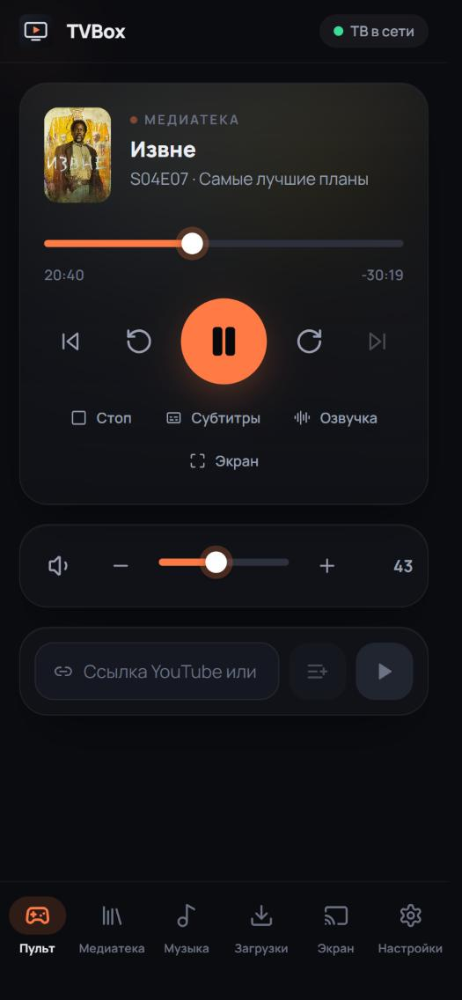
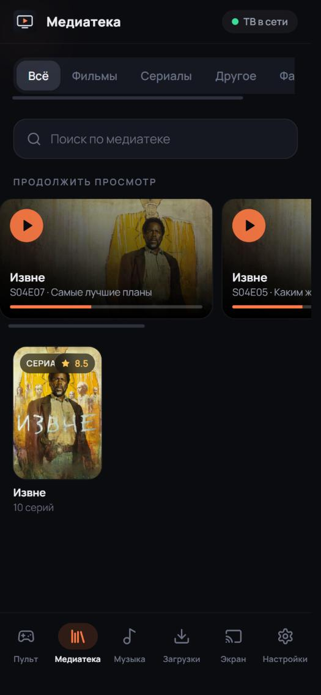
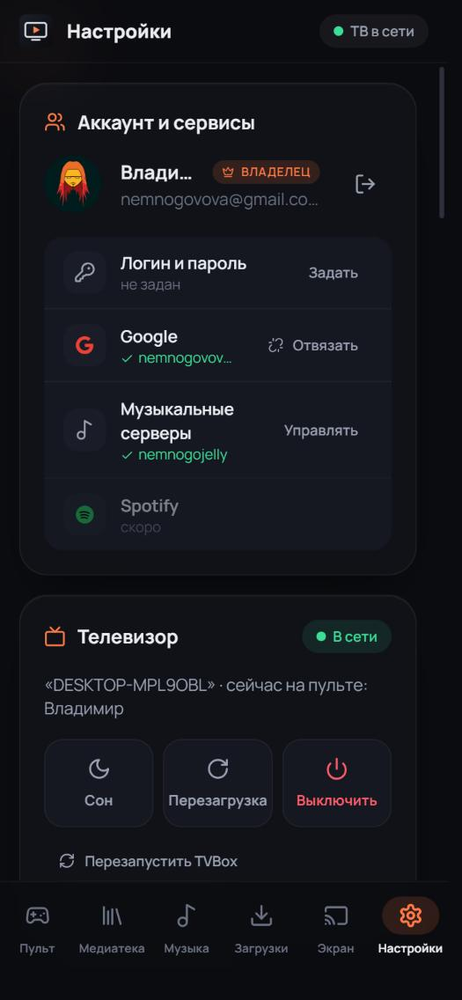
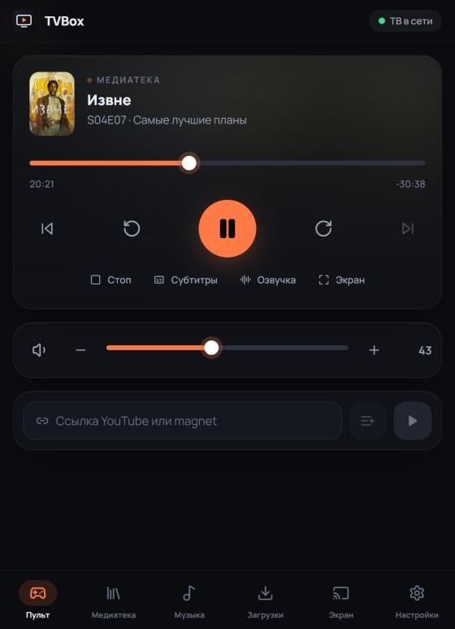
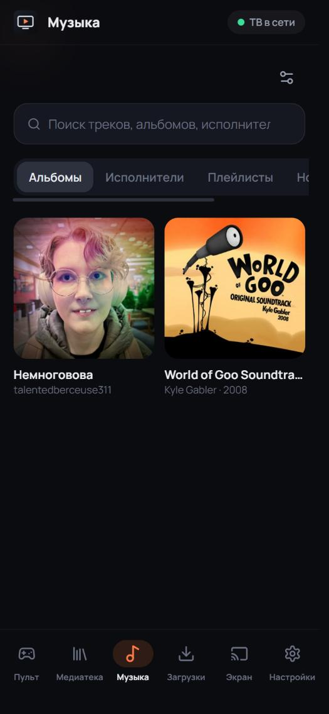
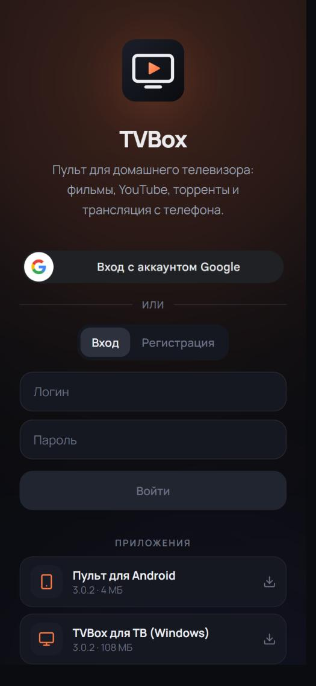

<p align="center">
  
  
  
  
</p>

<h1 align="center">📺 TVBox</h1>

<p align="center">
  <b>Превратите любой ПК у телевизора в умный медиацентр</b><br/>
  <sub>Управляйте с телефона. Смотрите что угодно. Без подписок, без облака, без ограничений.</sub>
</p>

<p align="center">
  <a href="#-быстрый-старт">Быстрый старт</a> ·
  <a href="#-возможности">Возможности</a> ·
  <a href="#-архитектура">Архитектура</a> ·
  <a href="#-разработка">Разработка</a>
</p>

---

<p align="center">
  
  &nbsp;&nbsp;
  
  &nbsp;&nbsp;
  
</p>
<p align="center">
  <sub>Пульт · Медиатека · Настройки</sub>
</p>

---

## Зачем

Вы подключили старый (или не очень) ПК к телевизору. Вам нужен один пульт на телефоне,
который умеет всё: запускать фильмы и сериалы, торренты, YouTube, музыку — и чтобы
это просто работало, без танцев с бубном.

**TVBox** — это именно это:

| Компонент | Что делает | Где живёт |
|-----------|-----------|-----------|
| **🖥 ТВ-клиент** | Плеер, YouTube, торренты, музыка, экран ожидания | Windows (Electron) |
| **📱 Пульт** | Управление, медиатека, загрузки, настройки | Браузер / PWA / Android APK |
| **☁️ Сервер** | Связывает пульт и ТВ, HTTPS, WebRTC-сигналинг | VPS (Docker, ~60 МБ ОЗУ) |

> Сервер **не хранит** ваши файлы и **не скачивает** торренты — он только пересылает команды.
> Всё тяжёлое происходит на вашем ПК у телевизора.

---

## ✨ Возможности

### 🎬 Плеер — играет всё



- **Локальные файлы** — MKV, AVI, MP4 и любые форматы с любыми кодеками
- **MKV с AC3/DTS** — звук перекодируется на лету через ffmpeg, видео копируется без потерь. Перемотка по опорным кадрам — **без рассинхрона**
- **Выбор озвучки и субтитров** с пульта — встроенные дорожки и внешние `.srt`. Длинные списки открываются в окне с поиском
- **Прогресс сохраняется** каждые 5 секунд. Фильм продолжится с того же места, следующая серия включится сама
- **Прямые ссылки** — вставьте URL видеофайла и смотрите

<br clear="both"/>

### 🔴 YouTube — настоящий, без ограничений

- Открывается как **полноценный youtube.com**, а не iframe — работают даже ролики, запрещённые для встраивания
- Войдите в свой аккаунт — подписки, Premium без рекламы, 18+ контент
- Вставьте ссылку на пульте (`Ctrl+V`) — видео сразу откроется на ТВ

### 🧲 Торренты — смотрите сразу

- **WebTorrent** с последовательной загрузкой — начните смотреть с первых процентов
- Перетащите `.torrent` или вставьте `magnet:` — всё
- После скачивания файл попадает в медиатеку с обложками TMDb

### 🎵 Музыка — ваши серверы



- **Jellyfin**, **Navidrome** и любые **Subsonic**-совместимые серверы
- Альбомы, исполнители, плейлисты, поиск
- Очередь, перемешивание, повтор, перемотка
- Кеш прослушанных треков на ПК (лимит настраивается, старые удаляются сами)

<br clear="both"/>

### 📱 Пульт — удобный, на любом устройстве

<table>
<tr>
<td width="50%">

**На телефоне:**
- Нижняя навигация: Пульт, Медиатека, Музыка, Загрузки, Экран, Настройки
- Крупные кнопки, мгновенный отклик ползунков
- Уведомление с кнопками управления на заблокированном экране
- **Кнопки громкости телефона** меняют громкость ТВ — даже с погашенным экраном

</td>
<td width="50%">

**На компьютере:**
- Двухпанельный режим: медиатека слева, пульт справа
- Горячие клавиши: `Пробел`, `←/→`, `↑/↓`, `M`, `F`
- Перетащите файл или торрент прямо в окно
- `Ctrl+V` ссылки YouTube / magnet → сразу на ТВ

</td>
</tr>
</table>

### 📡 Трансляция (WebRTC)

- Транслируйте **файл с телефона**, фото, экран ПК или камеру — прямо на ТВ
- P2P: через сервер идёт только сигналинг
- За «строгим» NAT поток пойдёт через встроенный TURN (ограничение: 4 Мбит/с на сессию)

### 🖼 Экран ожидания

- Часы, погода, «Продолжить просмотр», «Недавно добавленные», QR пульта
- Кастомные виджеты по API или HTML/CSS/JS (в изолированном iframe)
- Заставка: часы, обложки медиатеки, чёрный экран или **свои фото и видео** — по ссылкам или загруженные с телефона, со сменой по таймеру

### 👥 Многопользовательский доступ

- Вход по **логину/паролю** или через **Google**
- Новые пользователи регистрируются сами → ждут одобрения владельца
- Гости с ограниченными правами, «режим диктатора»
- Привязка и отвязка Google-аккаунта в настройках

### 🔄 Автообновление

- `build-windows.cmd` — **один клик**: повышает версию, собирает установщик Windows + APK Android, публикует на сервер
- ТВ-клиент скачивает обновление и ставит его без вопросов
- Телефон видит обновление в настройках

---

## 🏗 Архитектура

```
┌─────────────────────────────────────────────────────────────────┐
│                        🌐 VPS (~60 МБ)                         │
│  ┌──────────┐  ┌───────────────────┐  ┌──────────────────────┐ │
│  │  Caddy   │  │  Backend (Node)   │  │  coturn (TURN/STUN)  │ │
│  │  HTTPS   │──│  Socket.io хаб    │  │  WebRTC relay        │ │
│  │  автоTLS │  │  REST API         │  │  4 Мбит/с на сессию  │ │
│  └──────────┘  └──────────┬────────┘  └──────────────────────┘ │
└───────────────────────────┼────────────────────────────────────-┘
                            │ Socket.io
              ┌─────────────┴─────────────┐
              │                           │
     ┌────────▼────────┐        ┌─────────▼────────┐
     │  📱 Пульт       │        │  🖥 ТВ-клиент     │
     │                 │ WebRTC │                    │
     │  React + Vite   │◄──────►│  Electron          │
     │  PWA / APK      │  P2P   │  ffmpeg, SQLite    │
     │                 │        │  WebTorrent, TMDb  │
     └─────────────────┘        └────────────────────┘
```

```
tvbox/
├── packages/shared        # Типы, события, роли, парсер имён (общий код)
├── apps/backend           # Сервер: авторизация, Socket.io, WebRTC-сигналинг, REST
├── apps/remote-client     # Пульт: React + Vite + PWA + Capacitor (Android)
├── apps/tv-client         # ТВ: Electron + ffmpeg + SQLite + WebTorrent
└── deploy/                # Docker Compose + скрипт деплоя на VPS
```

---

## 🚀 Быстрый старт

### 1. Разверните сервер (одна команда)

```powershell
# С Windows — спросит пароль root один раз
powershell -ExecutionPolicy Bypass -File .\deploy.ps1
```

Скрипт сам поставит Docker, создаст swap, настроит HTTPS (Caddy + Let's Encrypt),
поднимет backend + coturn. Готово.

### 2. Соберите и опубликуйте

```
build-windows.cmd
```

Дважды кликните — скрипт:
1. Повысит версию
2. Прогонит тесты
3. Соберёт установщик Windows (.exe) и APK Android
4. Опубликует оба на сервер — кнопки скачивания появятся в пульте

> Ключи: `build-windows.cmd nobump` (не повышать версию), `build-windows.cmd nopublish` (не публиковать)

### 3. Подключите ТВ



1. Установите TVBox на ПК у телевизора
2. На экране появится QR-код и 6-значный код
3. Откройте пульт на телефоне, войдите, отсканируйте QR
4. Готово — управляйте!

<br clear="both"/>

---

## 🎮 Клавиатура у телевизора

Если рядом с ПК есть клавиатура:

| Клавиша | Действие |
|---------|----------|
| `Пробел` / `Enter` | Пауза / воспроизведение |
| `←` / `→` | Перемотка |
| `↑` / `↓` | Громкость |
| `F` | Полный экран |
| `Esc` | Стоп |
| `Ctrl+Shift+Q` | Выход из TVBox |

---

## 📦 Android APK

```bash
npm run apk
```

Нужен Android Studio (SDK + JDK). Скрипт соберёт release-APK, подписанный вашим ключом.

**Что умеет нативное приложение сверх PWA:**
- 🔊 Кнопки громкости телефона → громкость ТВ (даже с выключенным экраном)
- 🔔 Уведомление с кнопками управления на экране блокировки
- 🧲 Открытие `magnet:` ссылок и `.torrent` файлов прямо в TVBox
- 📤 «Поделиться» ссылкой YouTube из любого приложения → сразу на ТВ

> ⚠️ При первой сборке создаются `.android-release.jks` и `.android-release.json` — **сохраните их!**
> Обновления APK ставятся поверх только с тем же ключом подписи.

---

## 🛠 Разработка

```bash
npm install
npm test              # 61 тест: роли, сокеты, сессии, авторизация, медиатека, ffmpeg, ...
npm run typecheck      # TypeScript во всех пакетах

npm run dev:backend    # :3000
npm run dev:remote     # :5173 (проксирует API на :3000)
npm run dev:tv         # Electron в dev-режиме
```

### Стек

| | Технология |
|---|---|
| **ТВ-клиент** | Electron, TypeScript, ffmpeg, SQLite (better-sqlite3), WebTorrent |
| **Пульт** | React, TypeScript, Vite, Capacitor, PWA |
| **Сервер** | Node.js, Express, Socket.io, scrypt (пароли) |
| **Инфраструктура** | Docker Compose, Caddy (auto-HTTPS), coturn (TURN/STUN) |
| **Монорепо** | npm workspaces, общий пакет `@tvbox/shared` |

---

## 🔒 Безопасность

- Пароли хранятся как **scrypt**-хеши — не в открытом виде
- Сервер работает только через **HTTPS** (Caddy + Let's Encrypt, автопродление)
- WebRTC-сигналинг и управление ТВ — только для авторизованных пользователей
- TURN-сервер с аутентификацией и ограничением полосы (4 Мбит/с на сессию)
- APK подписан собственным ключом (v1 + v2 подписи)
- Контейнеры ограничены по памяти и числу процессов

---

<p align="center">
  <sub>Сделано для себя, чтобы просто смотреть кино на диване 🍿</sub>
</p>
